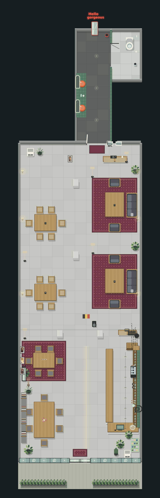
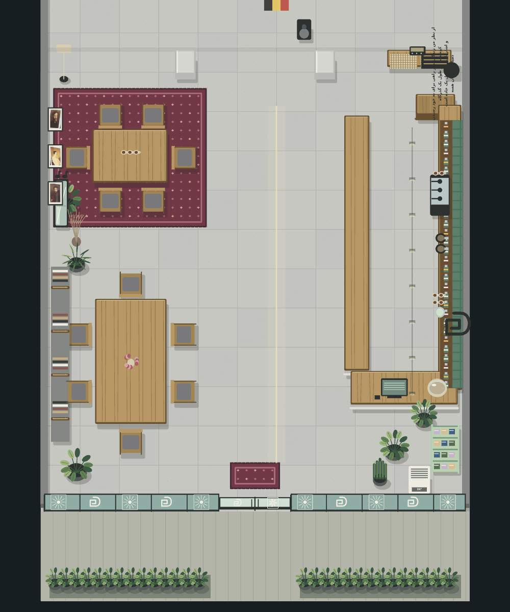
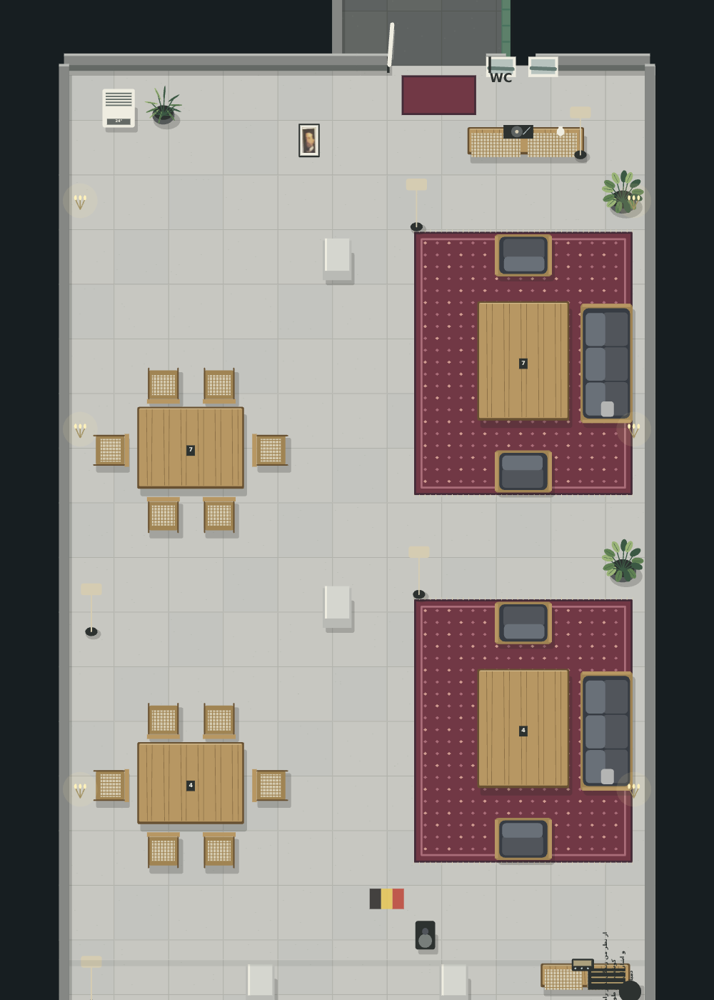
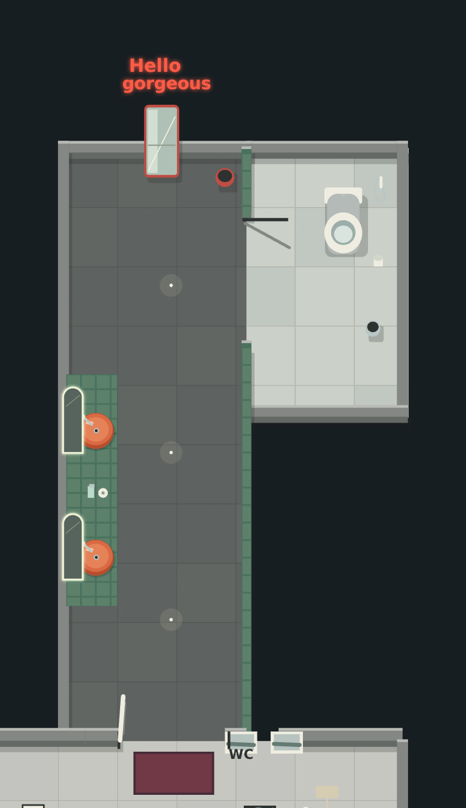

# بازسازی محیط کافه دمیان — از ورودی تا WC

این بازسازی بر مبنای سورس `Demian-main.zip` نسخهٔ ۱۴ و هر سه ویدیوی پوشهٔ `demian` انجام شده است. سبک نمایش، همان Canvas دوبعدی پروژه است. چیدمان نسخهٔ ۳، کل بخش‌های قابل مشاهده را به یک فضای پیوسته و قابل حرکت تبدیل می‌کند.

## تطبیق با ویدیوها

| بخش | جزئیات بازسازی‌شده | مرجع |
|---|---|---|
| ورودی | شیشه و قاب تیره، در دولنگه با دستگیره، نقش سفید روی شیشه، پادری زرشکی، سنگ‌فرش جلوی شیشه، دو باکس بامبو | ویدیوی ۱ |
| سالن جلو | کف تایل خاکستری، دیوار خاکستری، چهار ردیف کتاب، میز چوبی بزرگ، صندلی‌های چوبی، گلدان‌ها، آینهٔ مشکی با دو خروس، گلدان شاخه‌ای، سه پرتره، میز روی فرش زرشکی و آباژور | ویدیوی ۱ |
| بار | پیشخوان چوب و بتن، کاشی سبز، بطری‌ها، اسپرسوساز، آسیاب‌ها، فنجان و آبمیوه‌گیر، صندوق و چاپگر، ظرف شیرینی، قفسهٔ محصولات سبز روشن، کولر ایستاده، کاکتوس و برگ‌انجیری | ویدیوی ۱ |
| انتهای بار | بوفهٔ تیره با نمای حصیری، رادیو، ظروف، چهارپایه، نوشتهٔ دمیان/هرمان هسه | ویدیوهای ۱ و ۲ |
| گذر سالن | ستون‌ها و تیر سفید، چراغ‌های سقفی و پرچم سه‌رنگ دیده‌شده در فیلم | ویدیوهای ۱ و ۲ |
| سالن پشتی | دو گروه میز و صندلی در سمت چپ، دو مجموعهٔ لانژ سمت راست، مبل خاکستری در امتداد دیوار، مبل تک‌نفره در دو سوی میز، فرش زرشکی، چراغ دیواری و آباژور، گلدان، کولر | ویدیوی ۲ |
| انتهای سالن | بوفهٔ روشن حصیری با گرامافون و گلدان، دو تصویر کوچک، پرترهٔ کنار مسیر، در سفید با قاب تیره، علامت WC و پادری | ویدیوی ۲ |
| روشویی | کف و سقف تیره، کاشی سبز، دو کاسهٔ نارنجی، شیر کروم، دو آینهٔ قوسی با نور سفید، صابون و حوله، آینهٔ قدی قرمز، نوشتهٔ قرمز «Hello gorgeous»، سه چراغ و سطل قرمز | ویدیوی ۳ |
| کابین WC | دیوار و کف روشن، توالت سفید، شلنگ و شیر، جا‌دستمال و سطل فلزی، در و دهانهٔ قابل عبور | ویدیوی ۳ |

چهار تصویر کوچک پرتره، از قاب‌های خود ویدیوها بریده شده‌اند. اطلاعات منبع در `public/assets/reference/cafe/walkthrough/reference-art.json` ثبت شده است. اشخاص حاضر در فیلم‌ها وارد بافت‌ها نشده‌اند. ویدیوهای اصلی در این بسته تکرار نشده‌اند.

## دقت و مقیاس

رنگ‌ها، جنس‌ها، ترتیب فضاها، وسایل شاخص و جهت مبلمان با فیلم‌ها تطبیق داده شده‌اند. فیلم‌ها اندازه‌گذاری ندارند؛ طول و عرض اتاق‌ها، فاصلهٔ دقیق اشیا و حد فضاهای پنهان برآورد شده‌اند. واحدهای مختصات **واحد بازی هستند، نه متر**. این خروجی نقشهٔ اجرایی معماری یا مدل سه‌بعدی اندازه‌برداری‌شده نیست.

بخش‌های مجاور که در فیلم دیده نمی‌شوند بسته مانده‌اند. اتاق جانبی، آشپزخانه یا کابین دوم به محیط اضافه نشده است. درها در نمای بازی باز هستند تا مسیر حرکت قطع نشود. سقف شبکه‌ای در نقشه با دکمهٔ «سقف» قابل مشاهده است؛ نمای اصلی از بالا، مبلمان و راهروها را نمایش می‌دهد.

## اجرا و کنترل

پس از اعمال بسته روی پروژهٔ پایه، از پوشهٔ اصلی اجرا کنید:

```bash
python3 -m http.server 8080 --directory playable
```

آدرس `http://localhost:8080` را باز کنید و وارد کافه شوید. برای حرکت از WASD یا جهت‌ها، روی گوشی از جوی‌استیک و برای نقشه از M یا دکمهٔ ▦ استفاده کنید. دکمهٔ F بین نمای کامل و دنبال‌کردن شخصیت جابه‌جا می‌شود.

خروجی آماده نیاز به ساخت مجدد ندارد. برای تغییر سورس:

```bash
cd demian
npm ci
npm run test:ci
npm run validate:final
npm run validate:ui-layers
npm run build
node tools/export_static.mjs --out=../playable
npm run validate:build
```

هیچ migration، schema، فایل محیط، Dockerfile یا کد PHP در این تغییر اصلاح نشده است. اعمال این بسته نیازی به تغییر دیتابیس یا اجرای seed ندارد.

## ساختار تغییر

- `CafeWalkthroughScene.js`: دادهٔ واحد اتاق‌ها، دیوارها، درها، مبلمان، تزئینات، نور، سقف و مسیر بازدید.
- `CafeReferenceLayout.js`: برخوردها، محل NPCها، نقاط مخفی‌شدن و مسیرهای نقش‌آفرینی مطابق همان چیدمان.
- `CafeWalkthroughPainter.js` و `CafeWalkthroughPalette.js`: رسم مصالح و جزئیات، همراه با بارگذاری محلی پرتره‌ها.
- `CafePixelRenderer.js`: رسم محیط در بازی و نقشه با حذف اشیای خارج از دید.
- manifest محیط: شبکهٔ ۲ × ۷ با پنج بخش و پنج نقطهٔ ذخیره، از ورودی تا روشویی.
- `CafeTravelSafety.js`: انتقال امن ذخیره‌های قدیمی و جلوگیری از قرارگیری شخصیت داخل دیوار یا مبلمان.
- `CafeMapProjection.js`، نقشه و دوربین: تناسب طول و عرض، جهت یکسان با بازی، نمایش کل محیط و سقف اختیاری.

شناسه‌های نقاط ذخیرهٔ قبلی حفظ شده‌اند تا پیشرفت قبلی قابل استفاده بماند. جای شخصیت و بخش‌های کشف‌شدهٔ چیدمان قدیمی با چیدمان تازه تطبیق داده می‌شوند. هنگام باز بودن نقشه، حرکت متوقف می‌شود. خروج از کافه برای ورود به Dino Run، لایه‌های محیط و منابع آن را آزاد می‌کند.

## تصاویر و بررسی









نتیجهٔ تست‌ها و اندازه‌های مرورگر در `verification.json` و گزارش کامل مرورگر در `browser-qa.json` آمده است. مسیر ورودی تا کابین هم با شبکهٔ مسیریابی و نمونه‌برداری برخورد، و هم با حرکت واقعی شخصیت در مرورگر آزمایش شده است. سه شخصیت موجود، کنترل حرکت، نقشه، دکمهٔ سقف و ورود به Dino Run بررسی شده‌اند.

آزمایش مرورگر با Chromium و رسم نرم‌افزاری انجام شده است. کارایی، باتری و دمای گوشی واقعی اندازه‌گیری نشده‌اند. حقوق تصاویر مرجع و منابع ورودی تغییر نکرده است.
