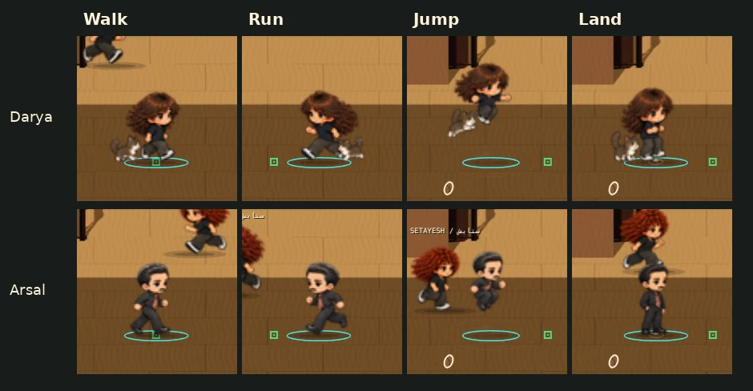

# مرجع حرکتی دریا و ارسل

دریا مرجع حرکت زن و ارسل مرجع حرکت مرد در استاندارد شخصیت‌های دمیان هستند. بازبینی این دو نمونه، پرترهٔ انتخاب کاراکتر و راه‌رفتن، دویدن، پرش و فرود را در Open World در نمای موبایل ۳۹۰×۸۴۴ CSS پیکسل پوشش می‌دهد.

## نتیجهٔ تأیید

**دریا و ارسل برای استفاده به‌عنوان مرجع بازطراحی کاراکترهای دمیان تأیید شدند.** انتخاب هر دو کاراکتر از رابط بازی انجام شد و راه‌رفتن، دویدن، پرش و فرود با کنترل‌های لمسی در Open World ضبط شد. هر دو در Chromium شبیه‌سازی‌شده، با نمای ۳۹۰×۸۴۴ و بستهٔ اجرایی V14 Lite بازبینی شدند.

اعداد چهار ستون حرکت، میانهٔ ارتفاع سیلوئت در پیکسل CSS هستند. ستون فاصلهٔ پا بیشترین فاصلهٔ زیر سیلوئت تا محور پا را در فریم‌های زمینی نشان می‌دهد.

| کاراکتر | راه‌رفتن | دویدن | پرش | فرود | بیشترین فاصلهٔ پا | نتیجه |
|---|---:|---:|---:|---:|---:|---|
| دریا | 88.4 | 90.4 | 94.4 | 94.4 | 1.69 | تأیید شد |
| ارسل | 90.4 | 90.4 | 74.3 | 92.4 | 2.33 | تأیید شد |

- **دریا** در هر دو جهتِ ضبط‌شده، چهره، مو، کفش‌ها و پیشی خوانا هستند. فریم فرود، بدن و همراه را به خط زمین بازمی‌گرداند.
- **ارسل** خط مو، نیم‌رخ و پوشش در تمام چهار حرکت قابل تشخیص‌اند. جمع‌شدن زانوها در پرش سیلوئت را کوتاه می‌کند و در فرود ارتفاع به حدود ۹۲ پیکسل برمی‌گردد.



ویدئوهای کامل، تصاویر خام و دادهٔ فریم‌ها در [خروجی اجرای ضبط](https://github.com/Parsa-Emami/Demian/actions/runs/45606548129/artifacts/15019100120) موجودند. نسخهٔ استاتیک `b242200f678d75dc` و SHA اجرا در [سند تأیید](acceptance.json) ثبت شده‌اند. [اجرای موفق GitHub Actions](https://github.com/Parsa-Emami/Demian/actions/runs/45606548129)

## اجرای بازبینی

از پوشهٔ `demian`، بستهٔ واقعی استاتیک بازی را بساز و ابزار ضبط را اجرا کن.

```bash
npm ci
python3 -m pip install Pillow
npm run validate:characters:v14
npm run build:static
npx playwright install chromium --only-shell
node tools/check_reference_art_mobile.mjs --site _site --out docs/character-reference-v2/evidence --sha "$(git rev-parse HEAD)"
```

اجرای GitHub Actions ویدئوی WebM، تصویر پرتره، تصویر لحظهٔ حرکت روی بوم بازی و گزارش اندازه‌گیری هر کاراکتر را در artifact همان SHA ذخیره می‌کند. اسکریپت شخصیت را از رابط بازی انتخاب می‌کند، با جوی‌استیک و دکمه‌های دویدن و پرش وارد حرکت می‌شود و فریم‌هایی را که موتور در صحنه کشیده است اندازه می‌گیرد.

| معیار | روش ارزیابی |
|---|---|
| هویت و ثبات چهره | پرتره و فریم‌های بازی با مشاهدهٔ ویدئو و نماهای حرکتی تطبیق داده می‌شوند. |
| مقیاس بدن | ارتفاع پیکسل‌های غیرشفاف فریم نسبت به ارتفاع مرجع اطلس سنجیده می‌شود. دامنهٔ راه‌رفتن، دویدن و فرود ۸۴ تا ۱۱۶ درصد است و برای جمع‌شدن بدن در پرش ۶۵ تا ۱۱۶ درصد در نظر گرفته می‌شود. |
| تماس با زمین | در نمونه‌های زمینی، ارتفاع فیزیکی صفر و فاصلهٔ پایین سیلوئت از محور پای اطلس حداکثر ۶ CSS پیکسل است. فرود باید پس از ارتفاع مثبت در بازی ثبت شود. |
| گام واقعی | در راه‌رفتن و دویدن باید هم جابه‌جایی در محیط و هم حداقل چهار فریم تصویری متمایز ثبت شود. |

## دامنهٔ تأیید

تأیید این دو نمونه برای بازطراحی شخصیت‌ها در شاخهٔ توسعه است. معیارهای دستگاه فیزیکی و پذیرش Production در [پروندهٔ بدهی هنری](../technical-debt/TD-ART-001-ART-REBUILD.fa.md) و [Issue #117](https://github.com/Parsa-Emami/Demian/issues/117) پیگیری می‌شوند.

پس از ثبت نتیجه، طاهر DB و سرخی اولین موج تطبیق با مرجع ارسل هستند. برای هرکدام هویت، تناسب سر و بدن، محور پا و انتقال بین دویدن، پرش و فرود را با خروجی مرجع مقایسه کن. شش نسخهٔ تولیدی V14 باید از یک منبع تأییدشده ساخته شوند.
