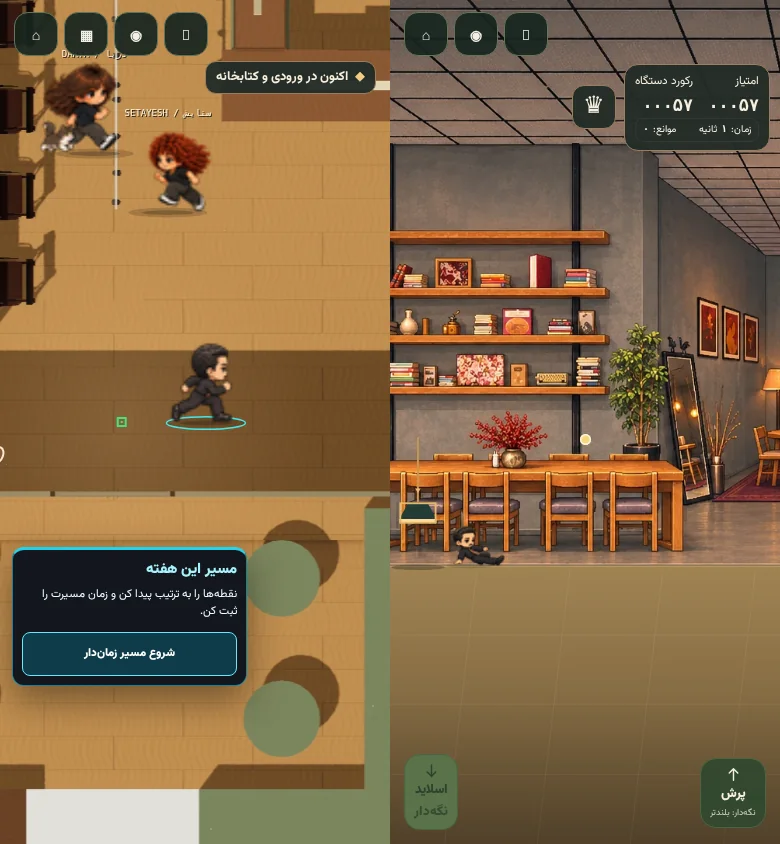

# ارسل V15

این نسخه ۱۱۲ پوز پایه برای هشت جهت دارد. نمای جلو کراوات و سبیل ارسل را حفظ می‌کند و در سه نمای پشت، نشان RETRO MIND خواناست. هر جهت از فریم‌های همان نما استفاده می‌کند. مقیاس هر شیت ورودی با اندازهٔ سر در نمای ایستاده تنظیم شده و محور پا در `(0.5, 0.94)` قرار دارد.

| بازی | پوشش ارسل |
| --- | --- |
| Open World | ایستادن، راه‌رفتن، دویدن، سرعت‌گرفتن، گردش، شروع و توقف، سه مرحلهٔ پرش، فرود، خم‌شدن و سلام در هشت جهت |
| Dino Run | نماهای بغل از پوزهای V14 و چرخه‌های مخصوص دویدن، پرش، فرود و اسلاید کم‌ارتفاع |
| After Hours و Café Rush | انتخاب از فهرست مشترک و پخش حرکت هشت‌جهته برای بازیکن |
| Café Critters، Coffee Crash و Café Drift | راه‌اندازی و جابه‌جایی بین بازی‌ها. این بازی‌ها آواتار دونده یا پیادهٔ بازیکن را نمایش نمی‌دهند |

جشن و برد در نمای هشت‌جهته از حرکت سلام استفاده می‌کنند. پوز خم‌شده ابتدای اسلاید Open World را می‌سازد. چرخهٔ مستقل اسلاید Dino Run سمت چپ و راست دارد. شروع حرکت برای مصرف‌کنندهٔ اطلس در دسترس است. تغییر جهت هنگام حرکت همان فاز گام را حفظ می‌کند. فیزیک، ارتفاع پرش و ثبت امتیاز را موتور بازی تعیین می‌کند.

## فایل‌ها و بازسازی

- [شیت پوزهای پایه](../../public/assets/characters/arsal/source-v15/poses.webp) و [مشخصات منبع](../../public/assets/characters/arsal/source-v15/layout.json)
- [قرارداد انیمیشن‌ها](../../public/assets/characters/arsal/manifests/arsal_animation_manifest_v15.json)
- [مرجع V14 دریا و ارسل و شواهد PR #132](../character-reference-v2/README.fa.md)

از پوشهٔ `demian` اجرا شود.

```bash
npm ci
python3 -m pip install -r tools/requirements-character-art.txt
npm run build:arsal:v15
npm run validate:character-art
python3 tools/audit_dcs_v15_scale_directions.py --version 15 --report /tmp/arsal-v15-scale.json
npm run build:static
npx playwright install chromium --only-shell
DEMIAN_QA_SITE=_site npm run test:arsal:browser
```

## نتیجهٔ بررسی

در Chromium `151.0.7922.34`، نسخهٔ استاتیک `7b7ea8fea182d54e` در نمای شبیه‌سازی‌شدهٔ موبایل ۳۹۰×۸۴۴ و دسکتاپ ۱۴۴۰×۹۰۰ اجرا شد. انتخاب کاراکتر، هشت جهت Open World، پرش، اسلاید Dino Run و بازشدن هر هفت بازی در هر دو نما تأیید شد. After Hours و Café Rush ارسل را با اطلس V15 بار کردند.

- در ضبط لمسی Open World بیشترین فاصلهٔ زیر سیلوئت ارسل تا محور پا حدود ۲٫۳ پیکسل CSS بود.
- فرود ۱۶۰ میلی‌ثانیه‌ای در مراحل جذب ضربه، باز شدن زانوها و ایستادن اجرا می‌شود. پس از کوتاه‌تر کردن نمایش پوز ضربه، میانهٔ ارتفاع فرود در ضبط موبایل ۹۳٫۸٪ ارتفاع مرجع بود.
- شش کیفیت از نظر تصویر، مرجع فریم و بودجهٔ حافظه بررسی شدند. Lite در خروجی استاتیک حدود ۴۸۶ KiB است و ۴ MiB حافظهٔ تصویر مصرف می‌کند.
- V14 در مخزن برای بازگشت نسخه و به‌عنوان منبع نماهای بغل نگهداری می‌شود. نتیجهٔ دستگاه فیزیکی در [Issue #117](https://github.com/Parsa-Emami/Demian/issues/117) پیگیری می‌شود.


