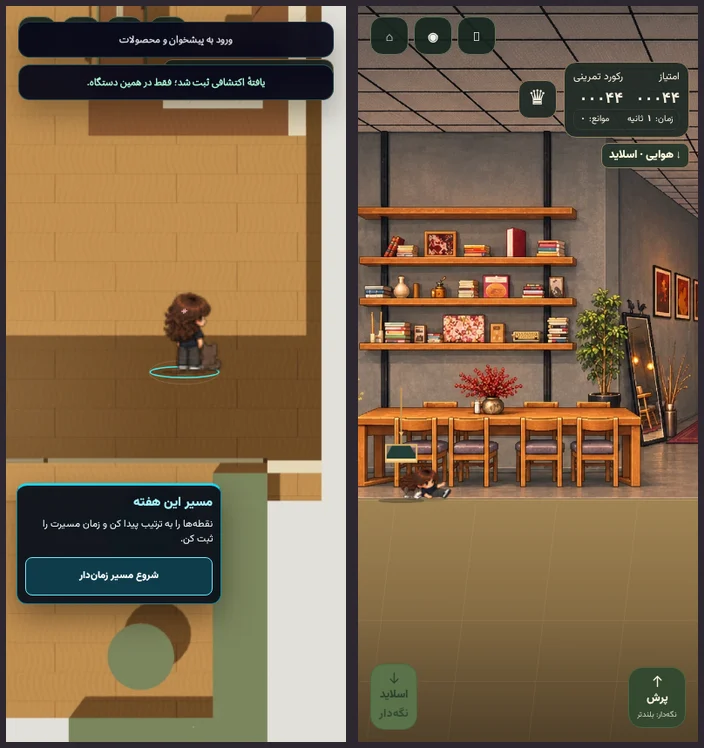

# دریا V15.1 و پیشی

چهره، مو و بالاتنهٔ دریا از تصاویر اصلی V15 در کامیت `911f544` گرفته شده‌اند. برش هر نما، شکل اصلی چشم‌ها و خط مو را در پرتره، جهان بازی و Dino Run حفظ می‌کند. لایهٔ چهره در انیمیشن‌ها همراه بدن جابه‌جا می‌شود. چرخهٔ راه‌رفتن ۱۲ پوز و چرخهٔ دویدن ۱۶ پوز رندرشده از اندام‌های مفصل‌بندی‌شده دارد. هر شش کیفیت تمام پوزهای راه‌رفتن و دویدن را دارند. Sprint از همان پوزهای دویدن با سرعت متناسب با مسافت طی‌شده استفاده می‌کند.

| بازی | پوشش دریا |
| --- | --- |
| Open World | راه‌رفتن، دویدن و Sprint در هشت جهت، گردش از نماهای میانی و دنبال‌کردن مسیر دریا توسط پیشی |
| Dino Run | چرخه‌های اختصاصی نمای بغل برای هر دو سمت، شامل دویدن، پرش، فرود و اسلاید. پیشی در مسیر خودش می‌دود و با تأخیر می‌پرد. |
| After Hours و Café Rush | دریا و پیشی در لایه‌های تصویری جداگانه |
| Café Critters | نمایش تصویر مستقل پیشی کنار سرنخ‌ها |

قاب منبع دریا ۱۶۰×۱۶۰ پیکسل و محور پا `(0.5, 0.94)` است. موقعیت پای تکیه‌گاه از مسافت واقعی طی‌شده محاسبه می‌شود. هنگام گردش، شمارهٔ گام در نماهای میانی حفظ می‌شود. پیشی شیت، محور پا، ارتفاع پرش و چرخه‌های مستقل دارد. موقعیت همراه در Open World از مسیر اخیر دریا و برخورد با اجسام ثابت تعیین می‌شود. جایزه، امتیاز و برخوردهای بازیکن از وضعیت پیشی تأثیر نمی‌گیرند.

## مقیاس مشترک

قد خنثی تمام ۲۶ کاراکتر در فضای بازی ۳٫۷۵ واحد است. Dino Run ارتفاع خنثی ۵۸ پیکسل منطقی دارد. برای هر کاراکتر، ارتفاع مرئی پوز ایستاده در اطلس دسکتاپ اندازه‌گیری شده و همان ضریب در تمام کیفیت‌ها اعمال می‌شود. این محاسبه مقیاس افقی و عمودی را با هم تنظیم می‌کند تا عرض طبیعی بدن، مو و لباس حفظ شود. جابه‌جایی‌های طبیعی بدن در دویدن، پرش و فرود از پوزهای خود کاراکتر می‌آیند.

دریا و ارسل در هر دو نمای بازی ضریب ایستادهٔ `0.70139` دارند. در کیفیت Lite سلول دریا ۴۴ پیکسل است و همهٔ پوزهای چرخه را در بودجهٔ حافظهٔ آن کیفیت جا می‌دهد.

- [اسپرایت‌شیت اصلی V15 دریا](../../public/assets/characters/darya/source-v15/poses.webp)
- [پرترهٔ دریا در منوی انتخاب](../../public/assets/characters/darya/darya-preview-v15.png)
- [هشت نمای منبع پیشی](../../public/assets/characters/darya/source-v15/pishi-turnaround.webp)
- [شیت مستقل پیشی](../../public/assets/characters/darya/pishi-spritesheet-v15-1.png)
- [چیدمان، محور پا و مشخصات منبع](../../public/assets/characters/darya/source-v15/layout.json)
- [حالت‌های انیمیشن V15](../../public/assets/characters/darya/manifests/darya_animation_manifest_v15.json)
- [اندازه‌های ایستاده و مرجع هر خانواده](../../resources/game/character-visual-standard-v2.json)

## بازسازی و بررسی

دستورها از پوشهٔ `demian` اجرا می‌شوند.

```bash
npm ci
python3 -m pip install -r tools/requirements-character-art.txt
npm run build:darya:v15
npm run validate:character-art
npm run build:static
DEMIAN_QA_SITE=_site npm run test:darya:browser
DEMIAN_QA_SITE=_site DEMIAN_QA_ENGINE=webkit npm run test:darya:browser
```

در بازبینی از نماهای منبع هم‌مقیاس، کنترل حاشیهٔ شفاف و محور پا، حرکت بر پایهٔ مسیر بازیکن و سنجش ورودی و رندر در مرورگر استفاده شد. آزمون بازگشت ۱۸۰ درجه، ترتیب نماهای میانی و پیوستگی گام را می‌سنجد. آزمون پیشی، حرکت همراه در Open World و پرش و فرود جداگانهٔ آن در Dino Run را بررسی می‌کند. نتایج مرورگر اجرای آزمایشگاهی را ثبت می‌کنند. آزمون روی گوشی فیزیکی انجام نشده است.

| مرورگر | اندازهٔ پنجره | نتیجه |
| --- | --- | --- |
| Chromium 151 | ۳۹۰×۸۴۴ و ۱۴۴۰×۹۰۰ | هفت بازی، تمام پوزهای راه‌رفتن و دویدن در هشت جهت، اسلاید و پرش پیشی |
| WebKit 26.5 | ۳۹۰×۸۴۴ با پروفایل iPhone 13 | همان پوشش حرکتی و راه‌اندازی هفت بازی |

پیکسل‌های سر در پرترهٔ فعلی با پرترهٔ کامیت `911f544` یکسان‌اند. آزمون اطلس در هر شش کیفیت، چهره را هنگام ایستادن و اجرای حرکت‌ها در هشت جهت و در نمای بغل Dino Run با منبع V15 تطبیق می‌دهد. ۹۴۴ آزمون جاوااسکریپت، بررسی PWA و سازگاری تب باز پس از انتشار پاس شدند. [جزئیات نتایج مرورگر](../../public/assets/characters/darya/manifests/darya_qa_status.json)


