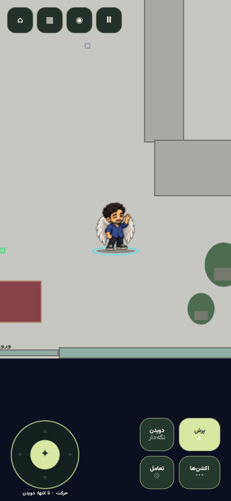
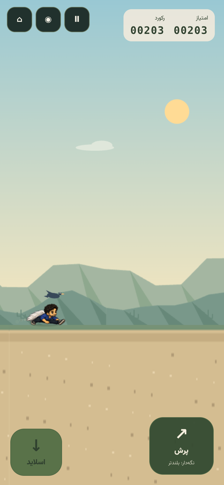

# امیررضا — کاراکتر بال‌دار V14

این گزارش معرفی اولیهٔ امیررضا در کامیت `11e9dd3` را ثبت می‌کند. اصلاح جدید حرکت امیررضا و تمام کاراکترها، شیت حرکت تازه و مشخصات بسته‌های اجرایی در [گزارش motion v2](../release-v14-smooth-motion/README.fa.md) آمده است.

امیررضا بر اساس تصویر مرجع ارسالی، با موهای مشکی فر، ته‌ریش و سبیل کوتاه، پیراهن آبی، شلوار تیره، کفش مشکی با کف روشن، ساعت مچی و بال‌های سفید طراحی و به کافه و Dino Run اضافه شده است. ساختار حرکت بال‌دار او با اوزودی مشترک است و فیزیک دویدن و پرش را از سیستم موجود بازی می‌گیرد.

تصاویر با ابزار داخلی `image_gen.imagegen` و پس‌زمینهٔ شفاف ساخته شده‌اند. پرامپت‌ها و نقش تصاویر مرجع در `imagegen-prompts.json` و هش ورودی‌ها در `public/assets/characters/amirreza/source-v14/layout.json` ثبت شده‌اند. تصویر شخصی مرجع در خروجی عمومی بازی قرار نگرفته است؛ فایل‌های منبعِ طراحی و پیش‌نمایش برای بازسازی بسته نگهداری می‌شوند.

## اسپرایت‌ها و حالت‌ها

سه شیت منبع شامل ۷۲ پوز تولید شده است. ۶۰ پوز در ساخت بسته استفاده می‌شود؛ پوزهای بلندِ ورود و خروج slide کنار گذاشته شده‌اند تا چرخهٔ سر خوردن از چهار پوز واقعاً کم‌ارتفاع ساخته شود. اندازهٔ بدن و سر به‌صورت یکنواخت تنظیم می‌شود. اسپرایت ایستاده برای ساخت slide فشرده نمی‌شود. نمای east ایستاده از قرینهٔ west ساخته می‌شود، چون نمای تولیدشدهٔ اولیه جهت اشتباه داشت.

ابزار موجود پروژه با optical flow تک‌تصویری فریم‌های میانی را می‌سازد. هر نسخهٔ کامل ۶۷۲ فریم دارد؛ نسخه‌های اجرایی همان نام فریم‌ها و ترتیب انیمیشن‌ها را با سلول‌های فیزیکی مشترک حفظ می‌کنند.

| نسخه | اندازهٔ سلول | سلول فیزیکی | حافظهٔ تصویر پس از decode |
| --- | ---: | ---: | ---: |
| desktop | 144×144 | 672 | 53.16 MiB |
| mobile | 112×112 | 672 | 32.16 MiB |
| compact | 80×80 | 672 | 16.41 MiB |
| runtime | 96×96 | 254 | 9.00 MiB |
| lite | 64×64 | 203 | 3.25 MiB |

اطلس ۲۴ حالت معنایی را پوشش می‌دهد: idle، breathe، blink، ready، walk، run، sprint، takeoff، jump، fall، land، slide، crouch، turn، wave، celebrate، win، tiptoe، hop، hover، skid، dash، dodge و salute. حالت‌هایی مانند dash/run یا salute/wave از کلیپ مشترک استفاده می‌کنند و فریم مستقل اضافی محسوب نمی‌شوند.

چرخش ایستاده هشت نما دارد. راه‌رفتن، دویدن، پرش، سقوط، فرود و سر خوردن کلیپ‌های چپ و راست دارند؛ مانند اوزودی، جهت‌های حرکت بازی به همین کلیپ‌ها نگاشت می‌شوند. بال‌ها در پرش باز و در slide جمع می‌شوند. سرعت چرخهٔ دویدن با اوزودی هماهنگ است؛ حرکت دست‌وپا در پرش بر اساس سرعت عمودی فیزیک جلو می‌رود. بال‌ها قوانین برخورد یا ارتفاع پرش را عوض نمی‌کنند.





## معماری و نصب

نام، ترتیب و نوع حرکت کاراکترها در تعریف مشترک ابزارهای ساخت ثبت شده است. سازندهٔ اطلس، roster عمومی، validator و بسته‌های سبک همین تعریف را مصرف می‌کنند. رجیستری frontend، انتخاب کاراکتر و خروجی `playable` نیز امیررضا را به‌عنوان ششمین کاراکتر آمادهٔ تولید معرفی می‌کنند.

Backend نسخهٔ بسته را از roster می‌خواند و نسخهٔ ذخیره‌شدهٔ قدیمی را برای امیررضا به V14 ارتقا می‌دهد. کلید cache شامل نسخهٔ بسته است تا URL قدیمی باقی نماند. CharacterManager تنظیمات بسته و نوع حرکتِ داخلی را هنگام ادغام رکوردهای قدیمی تصحیح می‌کند. Seeder رکورد موجود امیررضا را با همان شناسه به‌روز می‌کند و او را به‌صورت پیش‌فرض جایگزین دریا نمی‌کند. ورودی قدیمی `AmirRezaCharacterSeeder` نیز همین مسیر مشترک نصب را اجرا می‌کند.

در نصب Laravel، دستور موجود `php artisan db:seed --class=BuiltinCharacterSeeder` کاراکترهای داخلی را نصب می‌کند. ساختار دیتابیس، migrationها، `.env` و Dockerfile تغییر نکرده‌اند.

## شواهد تست

- هر ۲۸۰ تست JavaScript و ۱۴ تست PHP با ۱۰۹ assertion پاس شده‌اند.
- شفافیت، مرز فریم‌ها، تمام ارجاعات انیمیشن و ارتفاع slide در ۳۰ نسخهٔ گرافیکیِ شش کاراکتر بررسی شده‌اند. بیشترین ارتفاع slide امیررضا در نسخهٔ lite برابر 45.31px است؛ حد پرنده 46px است.
- Chromium در اندازه‌های 320×568، 390×844، 844×390، 768×1024 و 1440×900 بدون خطای runtime و بدون فایل خراب اجرا شده است.
- امیررضا از UI انتخاب شد؛ سر خوردن با لمس، عبور از پرنده، پرش با کیبورد، حرکت و جشن در کافه و بارگیری ساختار بال‌دار بررسی شدند.
- تست چرخهٔ دویدن و ترتیب فریم‌های پرش برای هر شش کاراکتر موفق است. ساخت Vite، بررسی لایه‌های UI و اعتبارسنجی bundle نیز موفق‌اند.

نتایج در `verification.json`، `browser-checks.json`، `runtime-packs.json`، `js-tests.txt` و `php-tests.txt` ثبت شده‌اند. این بررسی مرورگر با ابعاد موبایل شبیه‌سازی شده است؛ عملکرد GPU، باتری و FPS گوشی فیزیکی اندازه‌گیری نشده است.

## بازسازی بسته

```bash
python3 tools/build_character_pack_v14.py --characters amirreza
python3 tools/build_runtime_character_packs.py --characters amirreza --report docs/release-v14-amirreza/runtime-packs.json
npm run validate:characters:v14
npm run test:ci
npm run build
node tools/export_static.mjs --out=../playable
npm run validate:build
```

وابستگی‌های ابزار ساخت در `tools/requirements-character-art.txt` ثبت شده‌اند. تصاویر نهایی و manifestها در `public/assets/characters/amirreza/` و نسخهٔ قابل انتشار آن‌ها در `playable/assets/characters/amirreza/` قرار دارند.
