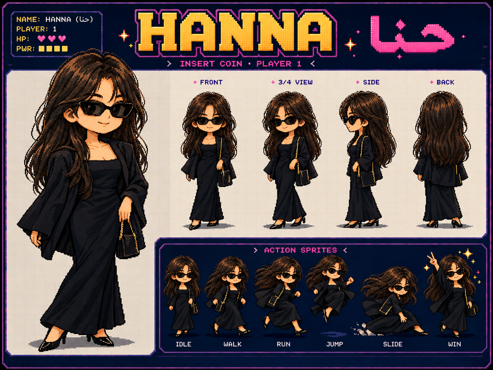
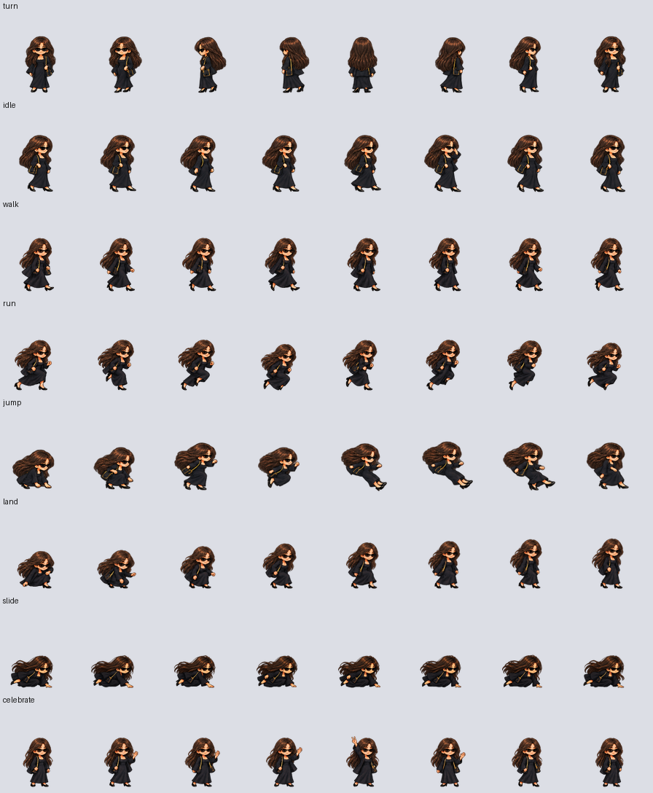
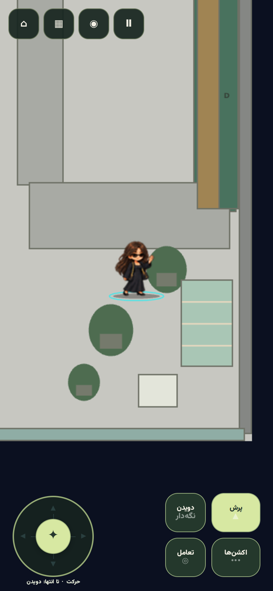
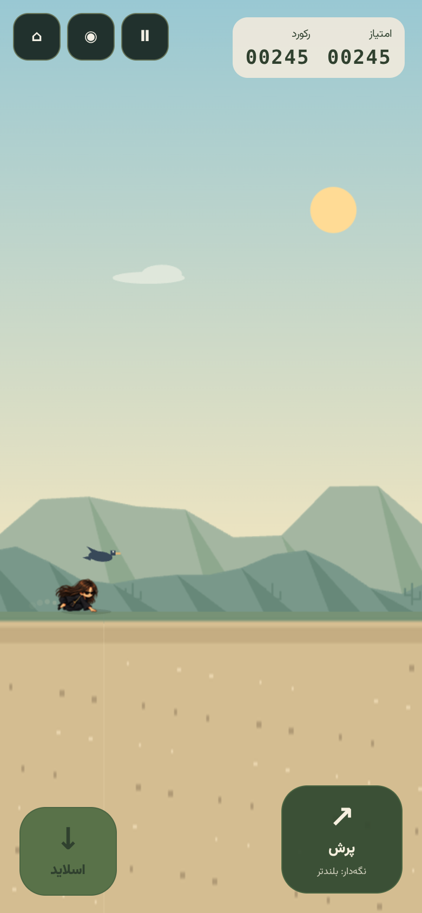

# حنا / HANNA — کاراکتر کامل V14

حنا از عکس ارسالی خودش و سبک شخصیت دریا طراحی شده است. تصویر شخصیت ابتدا با ابزار داخلی `image_gen.imagegen` ساخته شد؛ سپس پوزهای بازی با همان موهای بلند تیره، عینک آفتابی، لباس و کت مشکی، کیف کوچک با زنجیر طلایی و کفش نوک‌تیز ساخته شدند. تصویر مرجع در `public/assets/characters/hanna/hanna-reference-v14.png` و پرامپت‌های دقیق در `imagegen-prompts.json` قرار دارند.



## بستهٔ کامل انیمیشن

منابع شامل ۸۰ پوز ساخته‌شده هستند. ابزار بسته‌بندی ۶۰ پوز منتخب را به ۶۷۲ نام فریم تبدیل می‌کند. فریم‌های میانی با روش موجود `single-owner-optical-flow` ساخته می‌شوند؛ دو سیلوئت روی هم محو نمی‌شوند. این عدد به معنی ۶۷۲ پوز مستقل طراحی‌شده نیست.

| منبع | پوزهای استفاده‌شده |
| --- | --- |
| `source-v14/master.png` | ۸ جهت، ۸ idle و ۸ پوز پرش |
| `source-v14/runner-motion.png` | ۸ walk، ۸ run، ۸ land و ۸ celebrate |
| `source-v14/slides.png` | ۴ پوز بسیار کم‌ارتفاع از ردیف دوم |

ردیف‌های walk و land در master با شیت حرکت جایگزین می‌شوند. انتخاب ردیف‌ها، پوزها، هویت و هش ورودی‌ها در `source-v14/layout.json` مشخص است. عکس‌های شخصیِ ورودی در پوشهٔ عمومی بازی کپی نشده‌اند.

۲۴ حالت قابل استفاده عبارت‌اند از `idle`, `breathe`, `blink`, `ready`, `walk`, `tiptoe`, `run`, `sprint`, `takeoff`, `jump`, `fall`, `land`, `slide`, `crouch`, `turn`, `wave`, `salute`, `celebrate`, `win`, `hop`, `hover`, `skid`, `dash`, `dodge`. بعضی حالت‌های معنایی از کلیپ مشترک استفاده می‌کنند؛ نگاشت آن‌ها در manifest انیمیشن ثبت شده است. حالت پرش با سرعت عمودی واقعی بازی پیش می‌رود و slide از پوز کم‌ارتفاع مستقل استفاده می‌کند.



## حرکت ظریف و معماری مشترک

حنا از پروفایل `hanna-elegant-v2` استفاده می‌کند: طول چرخهٔ walk برابر 4.1، run برابر 6.8 و sprint برابر 7.4 واحد حرکت است؛ ریتم از 1.3 چرخه در ثانیه بالاتر نمی‌رود. حرکت بر اساس مسافت پیش می‌رود و هنگام تغییر gait، فاز پای تکیه‌گاه حفظ می‌شود. پوزهای اختصاصی، حرکت متقابل دست‌وپا، تاب مو و دامن و بازیابی متعادل پس از پرش را نشان می‌دهند.

این تنظیم فقط ارائهٔ بصری را تغییر می‌دهد. سرعت حرکت، ارتفاع و کنترل پرش، بافر فرمان، گرانش نزدیک اوج و پاسخ فرود، از مدل مشترک بازی می‌آیند. فیلدهای قابل تنظیمِ پروفایل به شناسه، طول قدم و حداکثر ریتم محدود شده‌اند؛ مقدار غیرمثبت، نامتناهی یا ریتم خارج از محدوده در زمان ساخت رد می‌شود. ابزار retime نیز همین تنظیم را از layout می‌خواند.

فهرست مشترک frontend و manifest عمومی اکنون هفت کاراکتر دارند. `CharacterManager`، سرویس تصاویر، انتخاب Arcade، نسخهٔ static و seeder عمومی، حنا را از همین فهرست می‌خوانند. برای او renderer یا فیزیک جداگانه ساخته نشده است. خروجی کامل در `public/assets/characters/hanna/` و نسخهٔ قابل اجرا در `playable/assets/characters/hanna/` است. manifest حنا هر پنج هدفِ تصویر و اطلس را اعلام می‌کند. هش PNG در اطلس ثبت شده و URL تصویر با همان هش بارگذاری می‌شود.

| نسخه | اندازهٔ سلول | اندازهٔ PNG | سلول فیزیکی | حافظهٔ decode |
| --- | ---: | --- | ---: | ---: |
| desktop | 144 | 3456×4032 | 672 | 53.16 MiB |
| mobile | 112 | 2688×3136 | 672 | 32.16 MiB |
| compact | 80 | 1920×2240 | 672 | 16.41 MiB |
| runtime | 96 | 1536×1920 | 316 | 11.25 MiB |
| lite | 64 | 1024×960 | 239 | 3.75 MiB |

runtime و lite همهٔ ۶۷۲ نام فریم را نگه می‌دارند؛ نام‌های میانی نزدیک به یک نمونهٔ فیزیکی اشاره می‌کنند. هزینهٔ دانلود در `runtime-packs.json` ثبت شده است. بودجهٔ ساخت runtime برابر 12 MiB و lite برابر 4 MiB است.

## بررسی و بازسازی

- هر ۲۹۴ تست JavaScript موفق است؛ انتخاب حنا، پنج هدف تصویر، هش فایل‌ها، ۲۴ حالت، نگاشت جهت‌ها، ریتم در ۳۰/۶۰/۱۲۰ هرتز و نگه‌داشتن فاز قدم تست شده‌اند.
- هر ۱۵ تست PHP با ۱۳۴ assertion موفق است؛ نصب مجدد حنا بدون رکورد تکراری، دریافت variantها و فعال‌کردن او از API بررسی شده‌اند.
- اعتبارسنجی ۳۵ اطلس برای هفت کاراکتر، همراه با شفافیت، خالی‌نبودن فریم‌ها، نبود بریدگی و پایین‌بودن slide موفق است.
- ساخت Vite، فهرست هفت کاراکتر و دو بازی، لایه‌های UI و هماهنگی bundle نسخهٔ قابل اجرا بررسی شده‌اند.
- Chromium 153 در پنج اندازهٔ 320×568، 390×844، 844×390، 768×1024 و 1440×900 بدون خطای runtime و درخواست خراب اجرا شد. حنا از UI انتخاب شد، با لمس از زیر پرنده گذشت، با کیبورد پرید و در کافه با ورودی واقعی حرکت کرد؛ بافر پرش روی تیک فرود، تفاوت پرش بلند/کوتاه و نبود حرکت اجباری در پرش درجا تأیید شدند. جزئیات در `verification.json` و `browser-checks.json` ثبت شده‌اند. ابعاد موبایل در مرورگر شبیه‌سازی می‌شوند؛ GPU، FPS و باتری گوشی فیزیکی اندازه‌گیری نشده‌اند.

```bash
python3 tools/build_character_pack_v14.py --characters hanna
python3 tools/build_runtime_character_packs.py --characters hanna --report docs/release-v14-hanna/runtime-packs.json
npm run validate:characters:v14
npm run test:ci
npm run build
node tools/export_static.mjs --out=../playable
npm run validate:build
```

برای نصب رکوردهای فهرست در نسخهٔ Laravel، seeder موجود `BuiltinCharacterSeeder` حنا را نیز نصب می‌کند. انتخاب در frontend و نسخهٔ static از manifest داخلی پشتیبانی می‌شود. schema، migration، `.env` و Dockerfile تغییر نکرده‌اند.




