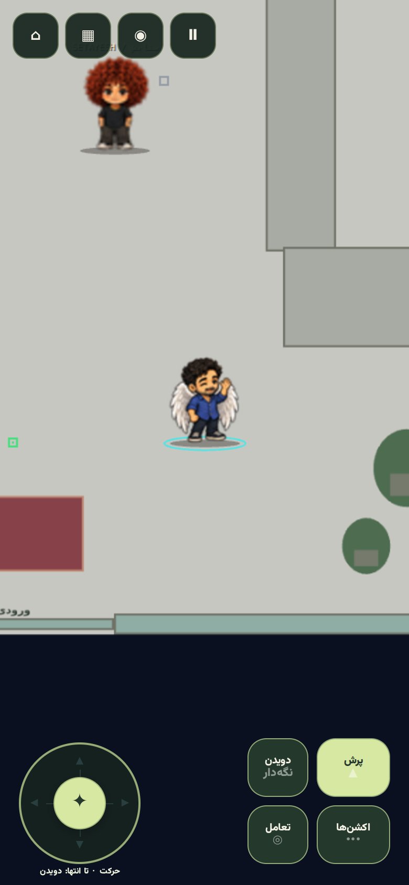
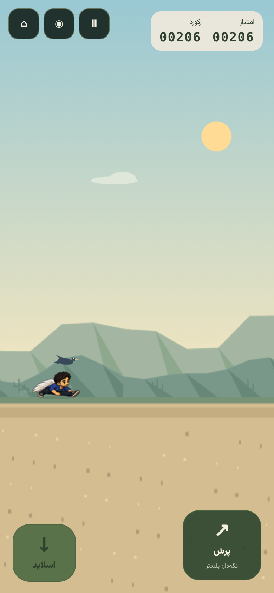

# حرکت روان‌تر شش کاراکتر — V14 / motion v2

امیررضا اکنون از همان مدل حرکت بال‌دار اوزودی استفاده می‌کند. شیت حرکت او از روی پوزهای واقعی اوزودی، به ترتیب راه‌رفتن، دویدن، پرش و فرود بازطراحی شده است. صورت، لباس آبی و بال‌های سفید امیررضا از مرجع هویت خودش حفظ می‌شوند. هر پنج اطلس امیررضا و اوزودی یک `locomotionProfile` یکسان با شناسهٔ `uzudi-wing-assisted-v2` دارند.

پوزهای جدید با ابزار داخلی `image_gen.imagegen` و پس‌زمینهٔ شفاف ساخته شده‌اند. پرامپت دقیق در `imagegen-retarget.json` است. شیت جدید در `public/assets/characters/amirreza/source-v14/runner-motion.png`، راهنمای اوزودی در `source-v14/uzudi-motion-guide.png` و ترتیب ردیف‌ها و هش مرجع در `source-v14/layout.json` ثبت شده‌اند. فایل منبع جدید ۳۲ پوز دارد؛ بستهٔ نهایی همچنان از ۶۰ پوز منتخب و ۶۷۲ نام فریم استفاده می‌کند.

## بهبود مشترک حرکت

- فاز قدم‌ها بر اساس مسافت طی‌شده پیش می‌رود. حرکت آهسته چرخهٔ دست‌وپا را آهسته‌تر می‌کند و برخورد با دیوار باعث ادامهٔ دویدنِ پاها در جای ثابت نمی‌شود. در Dino Run، سرعت نمایشی قدم‌ها همراه سرعت مسیر افزایش می‌یابد و محدود می‌شود.
- تغییر بین walk، run و sprint فاز کسریِ پای تکیه‌گاه را حفظ می‌کند. چرخهٔ دو مرحله‌ای دویدن تیام به همان فاز قدم مشترک نگاشت می‌شود. ریتم از 1.55 چرخه در ثانیه بیشتر نمی‌شود.
- آستانه‌های متفاوت ورود و خروج از حالت حرکت، پرش مکرر بین دو کلیپ بر اثر نوسان کوچک سرعت را کم می‌کنند.
- پیشروی فریم‌ها با محاسبهٔ مستقیم انجام می‌شود؛ بعد از توقف کوتاه مرورگر، فریم‌های عقب‌افتاده در یک صف چندمرحله‌ای باقی نمی‌مانند.
- سرعت‌ها، گرانش و کنترل هوا برای رکوردهای داخلی از تنظیم مشترک خوانده می‌شوند. تنظیم قدیمی یک رکورد، امیررضا را از مدل فیزیکی اوزودی جدا نمی‌کند.

مدل در هر دو renderer، یعنی `SpriteCharacter` در کافه و `CanvasCharacterAvatar` در Dino Run، مشترک است. اندازهٔ بدن یکنواخت و نمایش تک‌سیلوئت باقی می‌ماند؛ حرکت اندام از پوزها می‌آید.

## پرش و پاسخ به کنترل

قبل از این اصلاح، فرود در کافه حدود ۱۸۰ میلی‌ثانیه حرکت را قفل می‌کرد، اما بافر فرمان پرش ۱۴۰ میلی‌ثانیه بود. فرمانی که درست پیش از فرود می‌رسید ممکن بود پیش از پایان قفل از بین برود. اکنون پرش بافرشده روی همان تیک فرود اجرا می‌شود. حالت‌های بازیابی مانند land و skid با فرمان حرکت یا پرش قابل قطع‌اند؛ قفل اکشن‌های مستقل مانند توانایی نگار حفظ می‌شود.

هر دو بازی از تابع گرانش مشترک استفاده می‌کنند: هنگام نگه‌داشتن دکمه، گرانش نزدیک اوج با یک منحنی نرم تا 0.65 برابر کاهش می‌یابد؛ رهاکردن دکمه در صعود، گرانش را 1.65 برابر می‌کند. پرش کوتاه و بلند با کیبورد و لمس در کافه نیز قابل کنترل‌اند. پرش درجا دیگر سرعت افقی اجباری ایجاد نمی‌کند و پرش هنگام حرکت، تکانهٔ موجود را نگه می‌دارد. مهلت coyote موجود در کافه 110ms و بافر مشترک پرش 140ms است.

الهام از منابع سازندگان بازی‌ها گرفته شده است: مقالهٔ [Celeste & Forgiveness](https://www.mattmakesgames.com/articles/celeste_and_forgiveness/index.html) دربارهٔ بافر پرش، مهلت لبه و اوج نرم‌تر پرش، و [گزارش تیم Naughty Dog دربارهٔ Uncharted 4](https://www.naughtydog.com/blog/uncharted_4_a_thiefs_end_the_5_year_anniversary_retrospective) دربارهٔ روانی و پاسخ‌گویی حرکت. منطق فاز مبتنی بر مسافت و پیاده‌سازی این بسته، کد خود Demian است. تصویر یا کد بازی‌های مرجع وارد بسته نشده است.

## تراکم فریم و هزینهٔ تصویر

هر شیت کامل همچنان ۶۷۲ فریم دارد. runtime و lite نمونه‌های بیشتری برای walk/run/jump نگه می‌دارند؛ سیاست نمونه‌برداری برای هر خانواده در ابزار ساخت مشخص است. نقطهٔ شروع و پایان همهٔ اکشن‌ها حفظ می‌شود. زمان و نام فریم‌ها تغییر نمی‌کند. هش تصویر در اطلس ثبت می‌شود و بارگذاری PNG با همان شناسه انجام می‌شود تا مرورگر، تصویر ذخیره‌شدهٔ قدیمی را با مختصات اطلس جدید ترکیب نکند.

| معیار در هر کاراکتر | پیش از اصلاح | پس از اصلاح |
| --- | ---: | ---: |
| نمونهٔ واقعی walk در runtime | 22 | 33 |
| نمونهٔ واقعی run در runtime | 28 | 41 |
| سلول فیزیکی runtime | 254 | 316 |
| حافظهٔ decode در runtime | 9.00 MiB | 11.25 MiB |
| سلول فیزیکی lite | 201–203 | 239 |
| حافظهٔ decode در lite | 3.25 MiB | 3.75 MiB |

بودجهٔ ساخت برای runtime برابر 12 MiB و برای lite برابر 4 MiB است. انتخاب نسخهٔ سبک روی حالت performance و برای NPCها حفظ می‌شود. جدول کامل هر حالت و هر کاراکتر در `sampling-comparison.json` و اندازهٔ دانلود در `runtime-packs.json` ثبت شده است.

## شواهد تست

- هر ۲۹۰ تست JavaScript و ۱۴ تست PHP با ۱۰۹ assertion موفق‌اند.
- فاز قدم‌های هر شش کاراکتر در شبیه‌سازی ۳۰، ۶۰ و ۱۲۰ هرتز یکسان است. تغییر گام، توقف در برخورد، آستانه‌های حالت حرکت و پیشروی بدون صف فریم عقب‌افتاده تست شده‌اند.
- اعتبارسنجی هندسه، شفافیت، فریم‌ها، slide و مدل حرکت در هر ۳۰ اطلس موفق است.
- Chromium در اندازه‌های 320×568، 390×844، 844×390، 768×1024 و 1440×900 بدون خطای runtime و درخواست خراب اجرا شده است.
- هر شش کاراکتر در Dino Run از UI انتخاب شدند و با لمس از زیر پرنده عبور کردند و با کیبورد پریدند.
- در کافه، هر شش کاراکتر با ورودی کیبورد واقعاً حرکت کردند؛ پرش بلند، فرمان پرش پیش از فرود، اجرای آن روی تیک فرود، پرش دوم کوتاه و نبود حرکت افقی اجباری در پرش درجا بررسی شد. ترتیب فریم‌های صعود، اوج و سقوط در هر دو پرش پیش‌رونده است.
- توانایی نگار، همراه‌های دریا و تیام، انتخاب مشترک کاراکتر، لایه‌های UI و bundle اتمیک بررسی شده‌اند.

گزارش‌های قابل بررسی: `verification.json`، `browser-checks.json`، `js-tests.txt`، `php-tests.txt` و `runtime-packs.json`. مرورگر با ابعاد موبایل شبیه‌سازی شده است؛ FPS، GPU و باتری گوشی فیزیکی اندازه‌گیری نشده‌اند. افزایش جزئی حافظهٔ تصاویر در جدول بالا مشخص است.





## بازسازی

```bash
python3 tools/build_character_pack_v14.py --characters amirreza
python3 tools/retime_character_animation_v14.py
python3 tools/build_runtime_character_packs.py --report docs/release-v14-smooth-motion/runtime-packs.json
npm run validate:characters:v14
npm run test:ci
npm run build
node tools/export_static.mjs --out=../playable
npm run validate:build
```

منبع و خروجی قابل انتشار در `public/assets/characters/` و `playable/assets/characters/` هستند. schema دیتابیس، migration، `.env` و Dockerfile تغییر نکرده‌اند.
