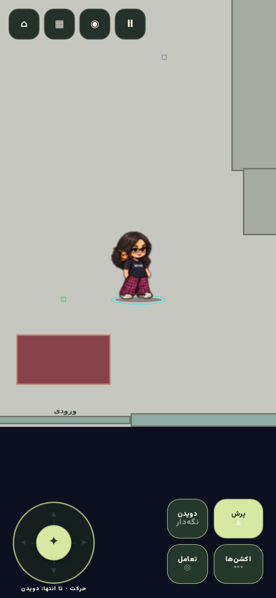
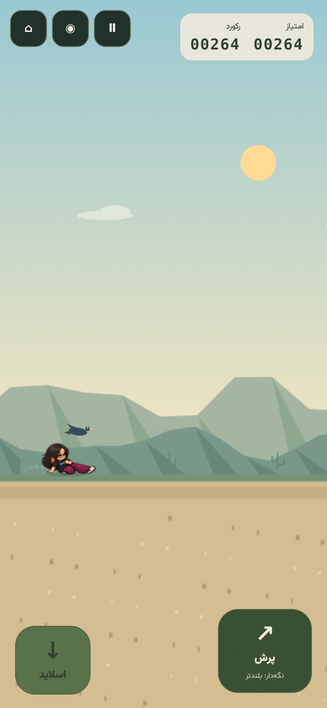

# تیام و همایون — بستهٔ قابل بازی V14

تیام بر اساس عکس ارسالی، با موهای تیرهٔ موج‌دار، عینک مشکی، تیشرت Demian، شلوار چهارخانهٔ صورتی و مشکی و کفش روشن طراحی شده است. سبک تصویر از شیت‌های مرجع دریا و ستایش پیروی می‌کند. همایون، سوسک کوچک روی شانه، در تصاویر مورد استفادهٔ بازی حضور دارد و برخورد مستقلی با محیط ندارد.

تصاویر با ابزار داخلی `image_gen` ساخته شده‌اند. منابع نهایی در `public/assets/characters/tiam/source-v14/` قرار دارند؛ نقش و هش تصاویر ورودی در `layout.json` ثبت شده است. پرامپت‌های ساخت و اصلاح در همین پوشهٔ گزارش نگهداری می‌شوند.

## تصاویر و انیمیشن‌ها

۸۰ پوز منبع تولید شده و ۷۱ پوز در ساخت فریم‌ها استفاده شده است. انتخاب پوزها در `source-v14/layout.json` مشخص است؛ فریم جشن با شانهٔ پوشیده از چرخه کنار گذاشته شده است. ابزار موجود پروژه، فریم‌های میانی را با optical flow تک‌تصویری می‌سازد. هر شیت کامل ۶۷۲ فریم دارد و اطلس ۲۴ حالت معنایی را معرفی می‌کند. بعضی حالت‌ها مانند sprint/run یا salute/wave کلیپ مشترک دارند.

| نسخه | اندازهٔ سلول | تعداد سلول فیزیکی |
| --- | ---: | ---: |
| desktop | 144×144 | 672 |
| mobile | 112×112 | 672 |
| compact | 80×80 | 672 |
| runtime | 96×96 | 254 |
| lite | 64×64 | 201 |

نسخه‌های runtime و lite همان نام فریم‌ها، ترتیب انیمیشن‌ها و مدت حرکت را با نمونه‌برداری کم‌حجم‌تر حفظ می‌کنند. راه‌رفتن، دویدن، پرش، سقوط، فرود و سرخوردن، فریم‌های جهت چپ و راست دارند. ردیف چرخش هشت نمای ایستاده را فراهم می‌کند.

حالت‌های اصلی: idle، breathe، blink، ready، walk، run، sprint، takeoff، jump، fall، land، slide، crouch، turn، wave، celebrate و win. حالت‌های tiptoe، hop، hover، skid، dash، dodge و salute نیز به کلیپ مناسب متصل هستند. حرکت سرخوردن از پوز کم‌ارتفاع مستقل ساخته شده است؛ ارتفاع پرش را فیزیک بازی تعیین می‌کند.





## اتصال به بازی

تیام در manifest، رجیستری JavaScript، فهرست انتخاب و خروجی ایستای `playable` ثبت شده است. محدودیت قبلی که تیام را از API و انتخاب کاراکتر حذف می‌کرد، برداشته شده است. مسیر فایل‌ها در frontend و backend به بستهٔ V14 اشاره می‌کند. انتخاب ذخیره‌شدهٔ تیام بین کافه و Dino Run حفظ می‌شود.

Seeder از manifest جدید استفاده می‌کند، همایون را در تنظیمات تیام ثبت می‌کند و اجرای دوبارهٔ آن شناسهٔ تیام را حذف و بازسازی نمی‌کند. برای نصب رکوردهای داخلی روی Laravel، دستور موجود پروژه `php artisan db:seed --class=BuiltinCharacterSeeder` قابل استفاده است. ساختار دیتابیس، migration، فایل `.env` و Dockerfile در این تغییر دست نخورده‌اند.

## اعتبارسنجی

- هر ۲۷۳ تست JavaScript و هر ۱۳ تست PHP پاس شده‌اند؛ PHP شامل ۸۹ assertion است.
- شفافیت، مرز فریم، ارجاع انیمیشن‌ها، نسخه‌های کم‌حجم و ارتفاع slide در هر ۲۵ بستهٔ گرافیکی پروژه بررسی شده‌اند.
- تست Chromium در ابعاد 320×568، 390×844، 844×390، 768×1024 و 1440×900 موفق بوده است.
- انتخاب تیام در UI، سرخوردن با لمس و عبور از پرنده، پرش با کیبورد، حرکت و جشن در کافه و بارگیری همایون بررسی شده‌اند.
- ساخت Vite، اعتبارسنجی لایه‌های UI و بررسی bundle اتمیک موفق بوده‌اند.

نتایج قابل بررسی در `verification.json`، `browser-checks.json`، `runtime-packs.json`، `js-tests.txt` و `php-tests.txt` قرار دارند. مرورگر با ابعاد موبایل شبیه‌سازی شده است؛ کارایی GPU و مصرف باتری تلفن فیزیکی اندازه‌گیری نشده‌اند.

## بازسازی

```bash
python3 tools/build_character_pack_v14.py --characters tiam
python3 tools/build_runtime_character_packs.py --characters tiam --report docs/release-v14-tiam/runtime-packs.json
npm run validate:characters:v14
npm run test:ci
npm run build
node tools/export_static.mjs --out=../playable
npm run validate:build
```

وابستگی‌های ساخت تصاویر در `tools/requirements-character-art.txt` ثبت شده‌اند. تصاویر بازی در `public/assets/characters/tiam/` و نسخهٔ منتشرشدنی آن‌ها در `playable/assets/characters/tiam/` قرار دارند.
