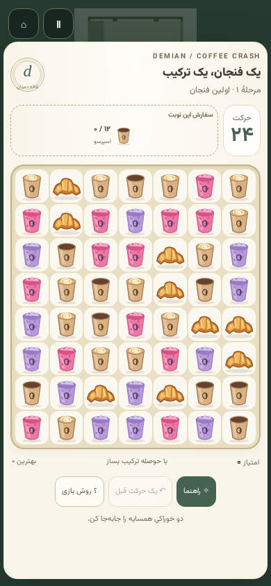

# Coffee Crash — جورچین قهوهٔ دمیان

از منوی انتخاب بازی، **COFFEE CRASH / جورچین قهوه** را انتخاب کنید.

بازی از تصویر مرجع الهام گرفته و با تصویرسازی برداری اختصاصی دمیان ساخته شده است. پنج خوراکی روی سینی ۷×۸ قرار دارند: اسپرسو، لاته، بری یخی، لاوندر و کروسان. دو خانهٔ مجاور را جابه‌جا کنید تا حداقل سه خوراکی یکسان در یک ردیف یا ستون کنار هم قرار بگیرند. سفارش‌های مرحله باید پیش از اتمام حرکت‌ها جمع شوند.

- ۱۲ مرحلهٔ متوالی با هدف‌های متفاوت و افزایش تعداد سفارش‌ها.
- چهارتایی: پاک‌کنندهٔ ردیف یا ستون؛ پنج‌تایی: فنجان رنگین؛ تقاطع T/L: بمب محدوده‌ای.
- فعال شدن زنجیره‌ای آیتم‌های ویژه، سقوط و پر شدن خانه‌ها، امتیاز آبشار تا ضریب ۵.
- جابه‌جایی نامعتبر رایگان؛ راهنمای رایگان؛ یک بار بازگشت حرکت در هر مرحله.
- تشخیص صفحهٔ بدون حرکت و بازچینی خودکار بدون کم شدن حرکت.
- انتخاب مرحله‌های بازشده، یک تا سه ستاره، بهترین امتیاز و ذخیرهٔ ترجیح نمایش راهنما در مرورگر.
- راهنمای اولیه با گزینهٔ «متوجه شدم و دیگر نمایش نده»؛ دسترسی دوباره از بازی و منوی توقف.

## کنترل‌ها

| ورودی | روش |
| --- | --- |
| گوشی | لمس دو خانهٔ مجاور یا کشیدن خانه به جهت همسایه |
| ماوس | کلیک روی دو خانهٔ مجاور یا کشیدن |
| صفحه‌کلید | فلش‌ها برای نشانگر؛ Enter یا Space برای انتخاب؛ Escape برای لغو انتخاب یا توقف |
| دستهٔ استاندارد | جهت‌ها برای حرکت بین کنترل‌ها؛ تأیید برای انتخاب؛ Start برای توقف |

بازی زمان‌دار نیست. سه ستاره با دست‌کم ۱۰ حرکت باقی‌مانده، دو ستاره با دست‌کم ۵ حرکت و یک ستاره با تکمیل سفارش در حرکت‌های کمتر ثبت می‌شود. ذخیرهٔ پیشرفت روی همان مرورگر و دستگاه است؛ همگام‌سازی حساب یا سرور ندارد.

## معماری

| ماژول | مسئولیت |
| --- | --- |
| `CoffeeCrashData` | اندازهٔ سینی، خوراکی‌ها، هدف‌ها، بذر و بودجهٔ حرکت مراحل |
| `CoffeeCrashModel` | قوانین خالص بدون DOM، تصادف بذرپذیر، ترکیب‌ها، آبشار، بازچینی و بازگشت دقیق وضعیت |
| `CoffeeCrashUi` | شبکهٔ دسترس‌پذیر DOM، ورودی اشاره‌گر، تمرکز، راهنما و نمایش رویدادها |
| `CoffeeCrashArt` | تصویرسازی SVG مستقل از شبکه و بدون دانلود خارجی |
| `CoffeeCrashRenderer` | پس‌زمینه با همان Canvas 2D و هندسهٔ کافهٔ دمیان |
| `CoffeeCrashStore` | ذخیرهٔ نسخه‌دار و اعتبارسنجی رکوردها، تحمل خطای localStorage |
| `CoffeeCrashGame` | اتصال چرخهٔ BaseGame، صف نمایش، تنظیمات، صدا، توقف و نتایج |

مدل هر حرکت را کامل و قطعی حل می‌کند و فریم‌های مستقل برای نمایش می‌سازد. ورودی تا پایان نمایش پذیرفته نمی‌شود. صف نمایش با به‌روزرسانی ثابت برنامه پیش می‌رود؛ توقف بازی، راهنما و خروج باعث ادامهٔ پنهانی صف یا تایمر معلق نمی‌شوند. بازگشت حرکت، صفحه، امتیاز، شمارنده‌ها و وضعیت مولد تصادف را با هم برمی‌گرداند. حداکثر ۶۴ آبشار و ۳۰۰ تلاش بازچینی، کار محاسباتی را محدود می‌کند. حالت کاهش حرکت، انیمیشن غیرضروری را حذف می‌کند.

تعریف بازی، کاتالوگ، زمینهٔ ورودی و کنترل‌های لمسی به سامانهٔ موجود متصل‌اند. خروجی یک بستهٔ اتمیک جاوااسکریپت است و نسخهٔ قابل اجرای `playable/` نیز به‌روز می‌شود. نسخه‌های موتور و وابستگی‌های موجود حفظ شده‌اند؛ Playwright فقط وابستگی توسعه برای تست مرورگر است.

## اعتبارسنجی

```bash
npm ci
npm run test:ci
npm run validate:skills
npm run validate:motion
npm run validate:cafe-presentation
npm run validate:characters:v14
npm run validate:final
npm run validate:ui-layers
npm run build:static
npm run validate:build
npx playwright install --with-deps chromium --only-shell
npm run test:coffee-crash:browser
```

تست مدل علاوه بر حرکت‌های معتبر و نامعتبر، آبشار، قدرت‌ها، مرزهای سینی، بازگشت تصادف، سقوط، بازچینی، آخرین حرکت و ذخیرهٔ خراب را بررسی می‌کند. فایل `tests/js/coffee-crash/solutions.json` یک مسیر برد آزموده‌شده برای هر دوازده مرحله دارد.

تست مرورگر روی اندازه‌های ۳۲۰×۵۶۸، ۳۹۰×۸۴۴، ۸۴۴×۳۹۰ و ۱۴۴۰×۹۰۰ و حالت کاهش حرکت اجرا می‌شود. لمس کشیدنی با CDP و دستهٔ استاندارد با ورودی شبیه‌سازی‌شده بررسی می‌شوند. این بررسی، اندازه‌گیری سخت‌افزار گوشی واقعی یا تضمین نرخ فریم آن نیست. گوشی‌های کوتاه و حالت افقی می‌توانند صفحهٔ داخلی را اسکرول کنند.

نتایج و تصاویر اجرای محلی در پوشهٔ `browser/` ثبت شده‌اند. گردش‌کار GitHub پیش از انتشار همین تست مرورگر را اجرا می‌کند و گزارش هر اجرای CI را در artifact با نام `coffee-crash-browser-qa` نگه می‌دارد.


